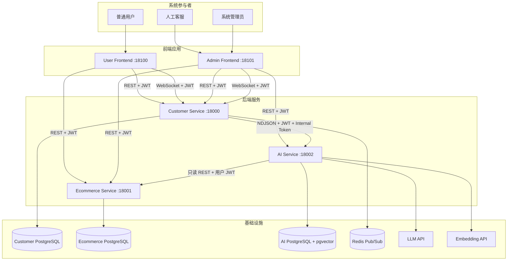

# ShopAgent

模拟用 AI Agent 赋能电商中台。让 AI 接管一部分业务流程。

## 项目结构

```text
ShopAgent
├── ai-service          # AI 相关服务
├── customer-service    # 客户相关服务
├── ecommerce-service   # 电商中台服务
└── frontend
    ├── user-frontend   # 用户前端
    └── admin-frontend  # 管理员前端
```

- User Frontend：面向普通用户，提供商城、订单和客服功能；端口：`18100`

- Admin Frontend：面向人工客服和管理员，提供人工工作台、知识管理和 AI 观测；端口：`18101`

- Customer Service：管理会话、消息、AI 调度、人工工单和实时通知；端口：`18000`

- Ecommerce Service：管理商品、订单、物流和售后业务数据；端口：`18001`

- AI Service：负责问题理解、业务查询、知识检索、回复生成和可靠性检查；端口：`18002`

## 配置与端口

所有服务的地址和端口统一来自仓库根目录的 `.env`。首次使用先从模板创建：

```shell
cp .env.example .env
```

各端口的默认值与用途如下（修改 `.env` 后需要重启对应服务）：

| 服务              | 配置项                                              | 默认值                |
| ----------------- | --------------------------------------------------- | --------------------- |
| User Frontend     | `USER_FRONTEND_HOST` / `USER_FRONTEND_PORT`         | `127.0.0.1` / `18100` |
| Admin Frontend    | `ADMIN_FRONTEND_HOST` / `ADMIN_FRONTEND_PORT`       | `127.0.0.1` / `18101` |
| Customer Service  | `CUSTOMER_SERVICE_HOST` / `CUSTOMER_SERVICE_PORT`   | `127.0.0.1` / `18000` |
| Ecommerce Service | `ECOMMERCE_SERVICE_HOST` / `ECOMMERCE_SERVICE_PORT` | `127.0.0.1` / `18001` |
| AI Service        | `AI_SERVICE_HOST` / `AI_SERVICE_PORT`               | `127.0.0.1` / `18002` |
| PostgreSQL        | `POSTGRES_HOST` / `POSTGRES_PORT`                   | `127.0.0.1` / `18200` |
| Redis             | `REDIS_PORT`（宿主机映射端口）                      | `18201`               |

前端 Vite 的开发服务器和预览服务器都读取 `USER_FRONTEND_*` / `ADMIN_FRONTEND_*`；后端 CORS 白名单由这两组前端地址自动派生，不再单独配置 `CORS_ORIGINS`。修改 `.env` 后需要重启对应服务；后端地址变化后前端需要重新构建，因为服务 URL 会在构建时写入产物。当前端 HOST 绑定 `0.0.0.0` 时，CORS 默认仍放行 `127.0.0.1` 和 `localhost` 的本机访问。

开发服务器和部署预览共用同一个端口，执行部署前需要先停止对应的 `npm run dev`。

## 一键部署

需要本机已安装 Docker（含 Compose v2）、uv、Node.js 18+ 和 npm。

```shell
python deploy.py          # 交互式菜单
python deploy.py deploy   # 构建并启动全部服务
python deploy.py status   # 查看服务状态
python deploy.py undeploy # 停止服务，保留数据卷
```

`ai-service` 当前尚未实现，构建和部署时会自动跳过；重置数据库使用 `python deploy.py reset-db`。

## 架构总览


