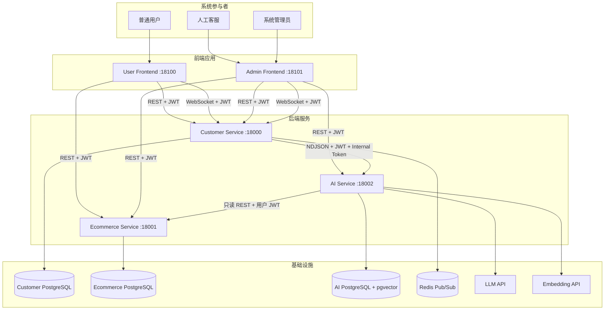

# ShopAgent

模拟用 AI Agent 赋能电商中台。让 AI 接管一部分业务流程。

## 项目结构

```text
ShopAgent
├── ai-service          # AI 相关服务
├── customer-service    # 客户相关服务
├── ecommerce-service   # 电商中台服务
└── frontend
    ├── user-frontend   # 用户前端
    └── admin-frontend  # 管理员前端
```

- User Frontend：面向普通用户，提供商城、订单和客服功能；端口：`18100`

- Admin Frontend：面向人工客服和管理员，提供人工工作台、知识管理和 AI 观测；端口：`18101`

- Customer Service：管理会话、消息、AI 调度、人工工单和实时通知；端口：`18000`

- Ecommerce Service：管理商品、订单、物流和售后业务数据；端口：`18001`

- AI Service：负责问题理解、业务查询、知识检索、回复生成和可靠性检查；端口：`18002`

## 架构总览


